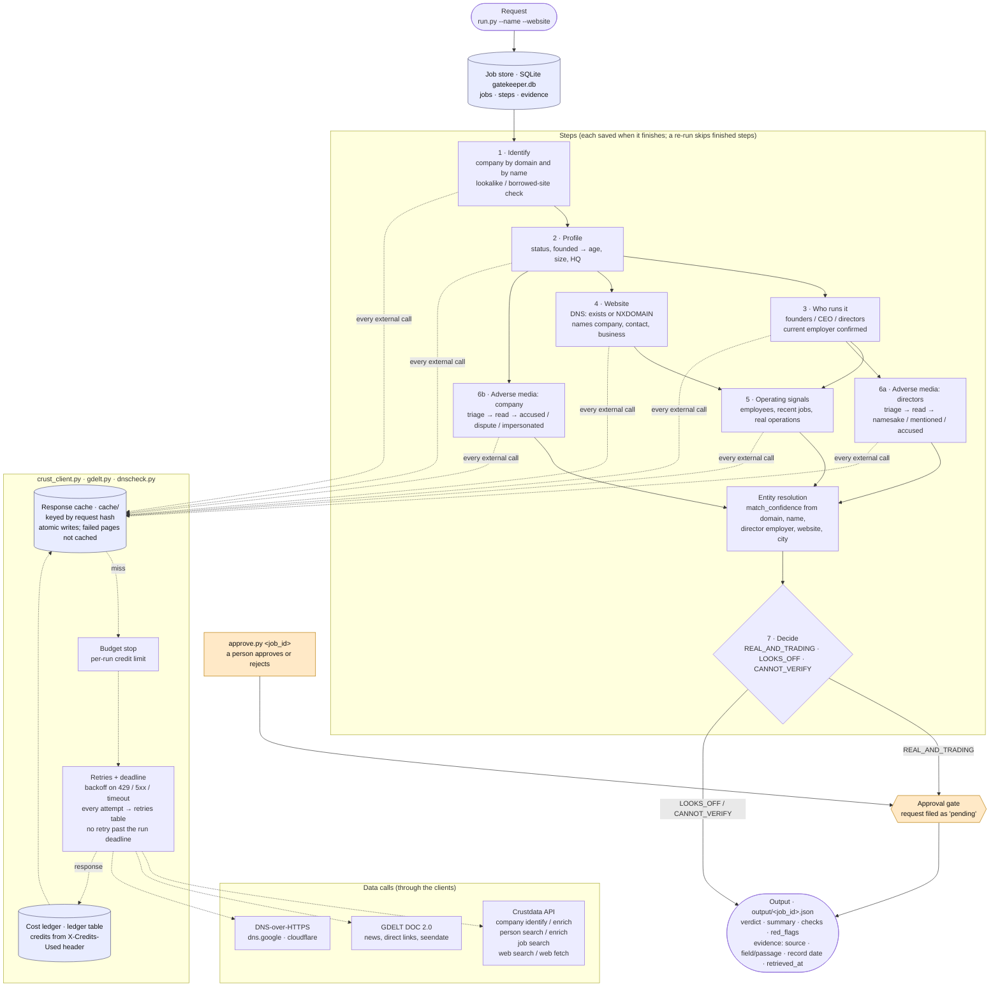

# Architecture

One request becomes one **job** (ID = hash of vendor name + website domain). The job runs a fixed
set of **steps**. Each step is saved in SQLite only when it finishes, so a run that is killed or
stops at its budget or time limit resumes where it stopped. Every external call goes through a
client that caches, retries, logs cost and respects the run's deadline.

## Where things sit

| Concern | Where | Notes |
|---|---|---|
| **Data calls** | Steps 1–6 → `crust_client.call`, `gdelt.search`, `dnscheck.lookup` | Every fact a step keeps becomes an evidence row with its source and retrieval time. |
| **Cache** | `cache/` (`crust_client._cache_path`, `gdelt._cache_path`) | A repeat call costs 0. Bot-check and failed pages are dropped from the cache so they get retried. |
| **Retries** | Inside each client | Every attempt and every give-up goes into the `retries` table and the output. The run deadline (limit − 15 s) caps any request or retry. GDELT gets 1 attempt, then is skipped for 15 min. |
| **Cost ledger** | `store.ledger`, written by `crust_client.call` | Credits actually charged, from `X-Credits-Used`. The output shows the job total and this run's spend. |
| **Budget stop** | `crust_client.call`, before each paid call | Over the per-run budget → the run stops, the verdict is `CANNOT_VERIFY`, and the next run resumes. |
| **Approvals** | `store.approvals`, `approve.py` | Only REAL_AND_TRADING files a pending request. Only a person (`approve.py`) clears a vendor. A changed verdict withdraws the request. |

## Parallelism

Steps that don't depend on each other run at the same time (3 workers), and their outputs are
merged back in pipeline order, so the result doesn't depend on which thread finished first:

- `who_runs_it` ∥ `website_check`
- `operating_signals` ∥ `adverse_media` ∥ `company_adverse_media`
- within the adverse-media steps: the leaders, the company searches and the page batches

## Decide, in order

1. Any unavailable source other than an unread adverse-media page → `CANNOT_VERIFY`. Unread
   adverse-media pages also give `CANNOT_VERIFY`, unless a page that *was* read already confirms a
   concrete negative.
2. Entity signals conflict → `CANNOT_VERIFY` (no company is picked).
3. A concrete negative, confirmed from a source we read → `LOOKS_OFF`. Concrete negatives are an
   accusing article about the company or a director, a lookalike domain, or a parked or default page.
4. Every check verified → `REAL_AND_TRADING` → approval gate.
5. Otherwise → `CANNOT_VERIFY`, with the list of what's missing.
